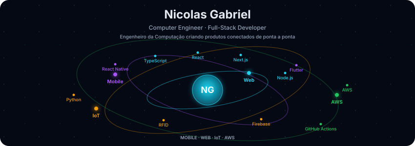
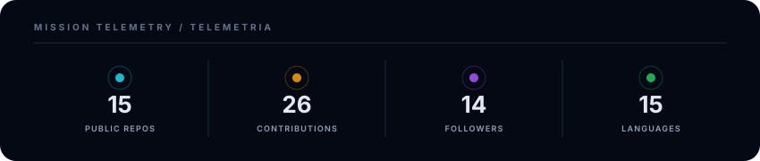
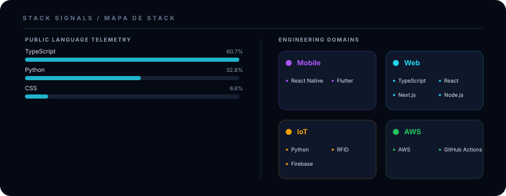
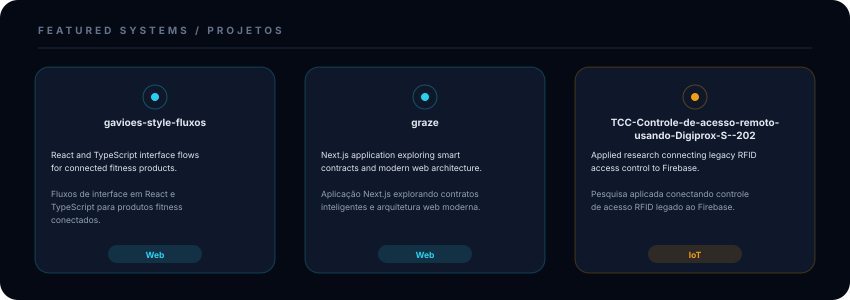

# Nicolas Gabriel

**Computer Engineer · Full-Stack Developer**  
Engenheiro da Computação criando produtos conectados de ponta a ponta

**Mobile · Web · IoT · AWS**  
React Native · Flutter · TypeScript · React · Next.js · Node.js · Python · Firebase

**CTO @ FireTheBox** · Mato Grosso, Brasil  
[GitHub](https://github.com/nicolas-takimo)

---

  

 

  

 

  

 

  

### Featured projects · Projetos em destaque

- [gavioes-style-fluxos](https://github.com/nicolas-takimo/gavioes-style-fluxos) — React and TypeScript interface flows · Fluxos de interface em React e TypeScript.
- [graze](https://github.com/nicolas-takimo/graze) — Next.js and smart-contract architecture · Arquitetura Next.js e contratos inteligentes.
- [TCC — RFID access control](https://github.com/nicolas-takimo/TCC-Controle-de-acesso-remoto-usando-Digiprox-S--202) — Legacy access control connected to Firebase · Controle de acesso legado conectado ao Firebase.

---

  Building connected products from interface to cloud · Criando produtos conectados da interface à nuvem

